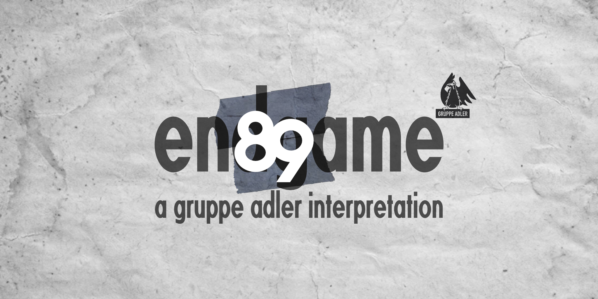

<div align="center">



# ENDGAME 1989

### One message. Two superpowers. One chance to send it.

**A team-versus-team-versus-militia game mode for Arma Reforger by [Gruppe Adler](https://github.com/gruppe-adler).**

*BLUFOR vs. OPFOR · Eden, 1989 · wave respawn · permadeath finale · AI militia everywhere*

</div>

---

## The pitch

It is 1989. The Eden archipelago is a powder keg, and the local militia (FIA) has stopped taking orders from anyone. Washington and Moscow both want the same thing: a decoded order that has to go out over the air from one of a handful of radio sites, and the first side to finish that transmission wins.

Nobody owns the ground. Not you, not the other side. The militia sits on **every** FOB, every document site and every radio site, and shoots at both of you. You get from the start line to the radio set in three steps, and every one of them is a fight:

1. **Take your FOB.** Wipe out the garrison. The first FOB to fall starts the clock for everyone.
2. **Steal the documents.** Search the marked areas, clear the site, copy the files. Three copies from three sites.
3. **Send the message.** Find the cipher, carry it to a radio site, and hold the transmitter for twelve minutes while the enemy tracks your signal.

It is a short, tense, three-act match that plays like a campaign compressed into an hour. No base building and no supply grind. Every phase asks a different question of the same squad.

---

## What makes it different

- **Three acts, three kinds of fight:** assault a garrison, race across the map for documents, then besiege a radio set.
- **Permadeath finale:** one free respawn per side in phase 3, then you stay dead.
- **Wave respawn:** the dead return together on a visible clock, so a lost fight costs minutes.
- **A fair race:** sites are chosen at random, but only selections where both sides travel about the same distance.
- **A hunted transmission:** the enemy gets a 300 m search area around your radio site every minute, and the set can be heard from 150 m away.
- **Information is a weapon:** the cipher carrier is never shown, document sites are areas and not points, and you never see the enemy's count.
- **A third faction:** FIA militia hold every site, scale with player count, patrol in UAZs and never respawn.
- **After-action replay:** the whole match replays on the map in fast forward before the results screen.
- **Typewriter HUD:** a typed field log with key strikes, a carriage return and a bell.

---

## A match at a glance

```
 ┌───────────────┐     first FOB cleared     ┌───────────────┐    3 document copies    ┌───────────────┐
 │  1 · FOB      │ ────────────────────────▶ │  2 · DOCUMENTS│ ──────────────────────▶ │  3 · RADIO    │
 │ clear your    │      (starts the clock    │ find, clear,  │   (cipher spawns,       │ carry the     │
 │ garrison      │       for both sides)     │ copy ×3       │    respawn ends)        │ cipher, send  │
 └───────────────┘                           └───────────────┘                         └───────┬───────┘
                                                                                               │
                                       transmission finished = win · one side eliminated = loss · 60 min = draw
```

| Phase | Your side does | It ends when |
| --- | --- | --- |
| **1. FOB** | Clear the militia from your FOB. It becomes your spawn, with an ammo box and light vehicles. | The first FOB on the map is cleared. |
| **2. Documents** | Search the marked areas, clear the site, hold the copy action for about 10 s. One copy per site per side. | One side has 3 copies from 3 sites. |
| **3. Radio** | Recover the cipher, bring it to a radio site and transmit for 12 minutes. | A transmission finishes, a side is eliminated, or time runs out. |

The full player briefing is in [docs/briefing.md](docs/briefing.md).

---

## The radio phase, in detail

The final phase is where the mode is decided, so it has the most rules.

- **Anyone can transmit.** Whoever carries the cipher can start a transmission, whatever their role. The cipher can be taken from a dead body.
- **The operator must stay put.** The transmission runs for 12 minutes, and the operator has to stay within 5 m of the set. If they leave, die or lose the cipher, the transmission **pauses**. Whoever restarts it continues from where it stopped.
- **Progress belongs to a side.** If the other side transmits at the same set, they start at zero.
- **Carrier down.** If the carrier dies or is knocked out, both sides get a task and a HUD notice with the last known position, blurred to within 25 m.
- **Direction finding.** The enemy gets a fresh 300 m search area around a transmitting site every minute.
- **Radio sites are contested.** Both sides may transmit at any site, so you can defend one, or attack and take over another.
- **Permadeath.** One free respawn per side, then no returns. If a side has no living players left, it loses.

---

## Controls

| Key | Shows |
| --- | --- |
| **Shift + J** | Field log: phase, time left, your document count, the order, recent notices |
| **Shift + K** | Dismiss the decoded order card |
| **Shift + T** | Show or hide the transmission card |
| **Shift + U** | Spectator card (dead in phase 3) |

Objectives are also in the vanilla task list and on the map. Each side only sees its own.

---

## For server admins

Everything tunable lives in the mission header, so a dedicated server changes the match with plain JSON and no code. The options are grouped under one `m_GRAD_Endgame` object:

| Group | What it controls |
| --- | --- |
| `m_Respawn` | Wave clock, wave size divisor, longest wait, late join window, free respawns, permadeath grace |
| `m_Factions` | Faction keys of both sides and the militia |
| `m_Fob` | FOB vehicle respawn time and radius |
| `m_Documents` | Active sites, copies per site, threshold to start phase 3, area radius, balance tolerance, whether the enemy's progress is visible |
| `m_Fia` | Garrison scaling per player, difficulty, tier sizes and group prefabs, vehicle patrols |
| `m_Radio` | Cipher prefab, transmission length, interrupt and role rules, direction finding mode, accuracy and interval, radio loop sound |
| `m_Hud` | Typewriter sound events |
| `m_Match` | Extra phase 3 time limit, elimination rule, replay on or off |
| `m_Debug` | Time scale (divides every timer), debug log, self tests. Keep these off for a real match |

A server override looks like this:

```json
{
  "game": {
    "gameProperties": {
      "missionHeader": {
        "m_GRAD_Endgame": {
          "m_Respawn":   { "m_fWaveSeconds": 180.0 },
          "m_Documents": { "m_iActiveDocumentSites": 5, "m_iDocumentThreshold": 3 },
          "m_Radio":     { "m_fTransmissionSeconds": 600.0 },
          "m_Debug":     { "m_fDebugTimeScale": 1.0 }
        }
      }
    }
  }
}
```

A complete list with every default is in [server_config.sample.json](server_config.sample.json), and the same values are set in [Missions/Endgame89.conf](Missions/Endgame89.conf). Set the debug time scale to `1` before a real match.

Every match writes a log (`$profile:GRAD_Endgame/match_*.log`) with each phase change, copy, transmission and cipher pickup, which makes balance tuning and disputes easy to settle.

### Requirements

| Dependency | Why |
| --- | --- |
| Arma Reforger (base game) | Eden terrain, 1980s US and USSR gear |
| COALITION Lobby | Game mode base: lobby, factions, spawn points and the after-action screen |
| Coalition VON | Voice and radios |

---

## For mission makers

Endgame is a small set of prefabs and one game-mode component. You can drop it onto another map.

| Prefab | Purpose |
| --- | --- |
| FOB (one per side) | The garrisoned starting objective; clearing it moves the side's spawn |
| `EG_IntelligenceFolder_E_01` | A document prop, placed on a free table near where you put it. Turn auto placement off to keep your own position |
| Radio site | A transmitter with the transmit action |
| Cipher site | A place where the cipher may appear, one chosen at random. It lies on a table nearby if one is free |
| Vehicle spots | Where FOB vehicles stand and where they are replaced when lost |
| Ammo pallets | Arsenal boxes at the FOBs, free of supply cost |

The map needs two FOBs, a number of document sites, at least two radio sites and at least one cipher site. The server picks which sites are active for each match and the selection is balanced by travel distance for the two sides.

The repository documents are the best place to start:

| File | What it covers |
| --- | --- |
| [docs/current-state.md](docs/current-state.md) | What works, what is only written, what is open. Read this first |
| [docs/briefing.md](docs/briefing.md) | The player-facing rules |
| [docs/test-routine.md](docs/test-routine.md) | What to check in a test session |
| [docs/garrison-orders-research.md](docs/garrison-orders-research.md) | How the AI garrisons are ordered |
| [Endgame 1989 implementation plan.md](Endgame%201989%20implementation%20plan.md) | The original plan and milestones |

---

## Status

Endgame is **in active development**. The core loop (FOB, documents, cipher and radio phase, wave respawn, FIA garrisons and vehicle patrols) has been played on both a listen server and a dedicated server. Several pieces were added or reworked after the last full test (table placement, the cipher on tables, the replay hand-off, the HUD key bindings, the grouped configuration), and [docs/current-state.md](docs/current-state.md) states plainly which are *played* and which are only *written*. Expect rough edges, and tell us about them.

---

## Credits

Made by **[Gruppe Adler](https://github.com/gruppe-adler)**.

- The replay system and the 1980s gearscripts are adapted from [BreakingContact](https://github.com/gruppe-adler/BreakingContact), our other Reforger game mode.
- Built on the COALITION Lobby and Coalition VON addons.
- Arma Reforger is a product of Bohemia Interactive. This is an unofficial community mod.

---

<div align="center">

*Take the FOB. Steal the files. Send the message.*

</div>
